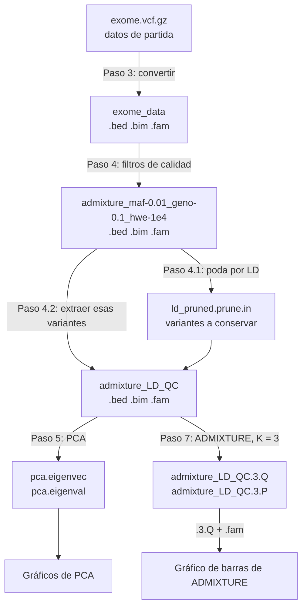

# Archivos que genera cada paso

Cada comando del notebook [`Ancestry_workshop.ipynb`](Ancestry_workshop.ipynb) crea archivos nuevos. Esta guía explica qué es cada uno, si se usa después y para qué.

## Mapa general

**Regla general:** PLINK siempre trabaja con tres archivos que comparten el mismo nombre (prefijo): `.bed` (genotipos), `.bim` (variantes) y `.fam` (individuos). Por eso `--bfile exome_data` significa "lee `exome_data.bed`, `exome_data.bim` y `exome_data.fam`". Cada comando de PLINK también escribe un `.log` con el resumen de lo que hizo.

## Paso 1. Descargar PLINK 2

| Archivo | Qué es | ¿Se usa después? |
|---|---|---|
| `plink2.zip` | La descarga comprimida | No: solo sirve para extraer `plink2` |
| `plink2` | El programa PLINK 2 | Sí: en los pasos 3, 4 y 5 |

## Paso 2. Descargar los datos

| Archivo | Qué es | ¿Se usa después? |
|---|---|---|
| `exome.vcf.gz` | Genotipos de 969 individuos en 244 305 variantes, en formato VCF (una tabla de texto) comprimido con gzip | Sí: es la entrada del paso 3 |

**Formato VCF:** las líneas que empiezan con `##` son el encabezado. Después viene una tabla con una fila por variante y estas columnas: `#CHROM` (cromosoma), `POS` (posición), `ID`, `REF` (alelo de referencia), `ALT` (alelo alternativo), `QUAL`, `FILTER`, `INFO`, `FORMAT` y una columna por individuo. Cada genotipo se escribe como `0/0` (dos alelos de referencia), `0/1` (uno de cada), `1/1` (dos alelos alternativos) o `./.` (dato faltante).

## Paso 3. Convertir el VCF al formato binario de PLINK

| Archivo | Qué es | ¿Se usa después? |
|---|---|---|
| `exome_data.bed` | Genotipos en formato binario (2 bits por genotipo). No se puede leer como texto | Sí: entrada del paso 4 |
| `exome_data.bim` | Una fila por variante: cromosoma, ID, posición genética (0 = desconocida), posición en pares de bases, alelo 1, alelo 2 | Sí: entrada del paso 4 |
| `exome_data.fam` | Una fila por individuo: ID de familia, ID del individuo, padre, madre, sexo (0 = desconocido), fenotipo (-9 = faltante) | Sí: entrada del paso 4 |
| `exome_data.log` | Registro del comando y resumen del resultado | No, pero es donde se revisa qué hizo PLINK |

**¿Por qué convertir?** El formato binario ocupa poco y se procesa rápido, y ADMIXTURE lo lee directamente.

## Paso 4. Control de calidad y poda por LD

### 4. Filtros de calidad

| Archivo | Qué es | ¿Se usa después? |
|---|---|---|
| `admixture_maf-0.01_geno-0.1_hwe-1e4.bed` / `.bim` / `.fam` | Los mismos datos, solo con las variantes e individuos que pasaron los filtros. El nombre indica los filtros usados | Sí: entrada de la poda por LD (pasos 4.1 y 4.2) |
| `admixture_maf-0.01_geno-0.1_hwe-1e4.log` | Resumen de los filtros | No, pero dice cuántas variantes e individuos eliminó cada filtro |

Con los datos del curso no se elimina ningún individuo; 13 175 variantes no pasan Hardy-Weinberg, 133 575 tienen frecuencia menor al 1 % y quedan 97 555 variantes.

### 4.1. Lista de variantes independientes

| Archivo | Qué es | ¿Se usa después? |
|---|---|---|
| `ld_pruned.prune.in` | Lista de IDs de las variantes que se conservan (aproximadamente independientes entre sí) | Sí: en el paso 4.2 |
| `ld_pruned.prune.out` | Lista de IDs eliminados por estar en LD con una variante que se conserva | No: solo para revisar |
| `ld_pruned.log` | Registro del comando | No |

Este paso no modifica los datos: solo escribe listas. Con los datos del curso se conservan 56 823 variantes y se eliminan 40 732.

### 4.2. Datos finales

| Archivo | Qué es | ¿Se usa después? |
|---|---|---|
| `admixture_LD_QC.bed` / `.bim` / `.fam` | Datos finales: pasaron el control de calidad y la poda por LD (969 individuos, 56 823 variantes) | Sí: entrada del PCA (paso 5) y de ADMIXTURE (paso 7). El `.fam` además identifica a cada individuo en los gráficos |
| `admixture_LD_QC.log` | Registro del comando | No |

**¿Por qué podar por LD?** El PCA y ADMIXTURE suponen que las variantes son independientes. Las variantes en LD repiten la misma información y le darían demasiado peso a algunas regiones del genoma (Alexander et al., 2009; Price et al., 2008).

## Paso 5. Análisis de componentes principales (PCA)

| Archivo | Qué es | ¿Se usa después? |
|---|---|---|
| `pca.eigenvec` | Una fila por individuo (`#FID`, `IID`) con su posición en PC1 a PC10 | Sí: para el gráfico de PC1 vs PC2 |
| `pca.eigenval` | 10 números, uno por PC: cuánta variación captura cada uno | Sí: para el gráfico de eigenvalores |
| `pca.log` | Registro del comando | No |

Los gráficos se muestran en el notebook y no se guardan como archivos.

## Paso 6. Descargar ADMIXTURE

| Archivo | Qué es | ¿Se usa después? |
|---|---|---|
| `admixture_linux-1.3.0.tar.gz` | La descarga comprimida | No: solo sirve para extraer la carpeta `dist/` |
| `dist/admixture_linux-1.3.0/admixture` | El programa ADMIXTURE | Sí: en el paso 7 |
| `dist/admixture_linux-1.3.0/admixture32` | Versión para computadores antiguos de 32 bits | No |
| `dist/admixture_linux-1.3.0/admixture-manual.pdf` | El manual de ADMIXTURE | No, pero vale la pena leerlo |
| `dist/admixture_linux-1.3.0/README.32.txt` | Notas sobre la versión de 32 bits | No |

## Paso 7. Correr ADMIXTURE

| Archivo | Qué es | ¿Se usa después? |
|---|---|---|
| `admixture_LD_QC.3.Q` | Proporciones de ancestría: una fila por individuo (mismo orden que el `.fam`) y una columna por componente ancestral; cada fila suma 1 | Sí: para el gráfico del paso 8, junto con `admixture_LD_QC.fam` para saber de quién es cada fila |
| `admixture_LD_QC.3.P` | Frecuencia alélica de cada variante en cada componente ancestral: una fila por variante (mismo orden que el `.bim`) y una columna por componente | No en este notebook. Sirve para proyectar individuos nuevos sobre los mismos componentes |

El `3` del nombre es K. ADMIXTURE no escribe archivo `.log`: sus mensajes solo aparecen en la salida de la celda.

## Paso 8. Gráfico de ADMIXTURE

No crea archivos: el gráfico se muestra en el notebook. Para guardarlo, clic derecho sobre la imagen, o agregar `plt.savefig('admixture_K3.png', dpi=300)` antes de `plt.show()`.

## Resumen: qué necesita cada análisis

| Análisis | Archivos que usa |
|---|---|
| PCA (paso 5) | `admixture_LD_QC.bed`, `.bim`, `.fam` |
| ADMIXTURE (paso 7) | `admixture_LD_QC.bed`, `.bim`, `.fam` |
| Gráficos de PCA | `pca.eigenvec`, `pca.eigenval` |
| Gráfico de ADMIXTURE | `admixture_LD_QC.3.Q` + `admixture_LD_QC.fam` |

## Referencias

- Alexander DH, Novembre J, Lange K. Fast model-based estimation of ancestry in unrelated individuals. *Genome Res*. 2009;19:1655–1664. doi:10.1101/gr.094052.109
- Chang CC, et al. Second-generation PLINK: rising to the challenge of larger and richer datasets. *GigaScience*. 2015;4:7. doi:10.1186/s13742-015-0047-8
- Danecek P, et al. The variant call format and VCFtools. *Bioinformatics*. 2011;27:2156–2158. doi:10.1093/bioinformatics/btr330
- Price AL, et al. Long-range LD can confound genome scans in admixed populations. *Am J Hum Genet*. 2008;83:132–135. doi:10.1016/j.ajhg.2008.06.005
- Purcell S, et al. PLINK: a tool set for whole-genome association and population-based linkage analyses. *Am J Hum Genet*. 2007;81:559–575. doi:10.1086/519795
